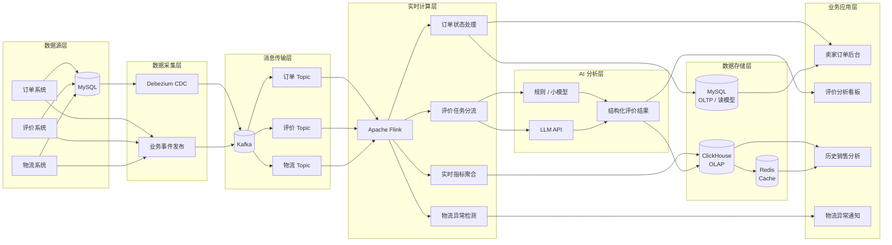

# Q5.1 - 实时数据管道设计

## 📋 题目背景

Olist 当前的数据是离线 CSV 导出。现在业务需求是——卖家希望**实时**看到自己的订单情况、买家评价、物流异常。

请设计一个**实时数据架构**，满足：

- 订单状态变更后 **30 秒内** 反映在卖家后台
- 评价文本进来后 **1 分钟内** 触发情感分析 + LLM 抽取
- 物流异常（如某订单延迟超过预计时间）**自动报警**到卖家
- 历史数据查询（卖家想看过去 6 个月的成交曲线）**毫秒级响应**
- 当前数据规模：**10 万订单/天**，预计 2 年内增长到 **100 万订单/天**

要求：800-1500 字 + 一张架构图

---

## 1. 整体架构图

## 2. 数据存储选型

采用分层存储，避免业务事务、消息传输和历史分析相互影响。

| 类型 | 技术 | 存储内容及选择原因 |
|---|---|---|
| OLTP | MySQL 8.0 | 保存订单、支付及业务状态，支持事务和高频更新；不承担大规模历史分析。 |
| 消息队列 | Kafka | 传递订单、评价和物流事件，支持消息持久化、多消费者订阅及故障后的消息重放，实现上下游解耦。 |
| OLAP | ClickHouse | 保存历史交易明细、评价结果和销售汇总，利用列式存储及预聚合提高历史分析效率。 |
| 缓存 | Redis | 缓存卖家近期订单、热门销售指标及查询结果，减少重复访问数据库的开销。 |

数据通过 Debezium 读取 MySQL Binlog 捕获变更，再发送至 Kafka；Flink 消费事件并进行实时处理，分别写入独立的业务读模型和 ClickHouse。Redis 缓存高频查询结果。原始业务数据库与下游读模型分离，避免处理结果再次进入 CDC 源库形成事件循环。

## 3. LLM 成本控制

以未来每天 100 万订单为测算基准。由于题目没有提供未来实际评价率，假设评价率为 20%，每条评价平均消耗 500 个输入 Token、150 个输出 Token。

采用 DeepSeek-V4.1-Flash API（模型名称：`deepseek-flash`），按官方高峰时段价格计算：输入缓存未命中 $0.30/百万 Token，输出 $1.20/百万 Token。

| 指标 | 结果 |
|---|---:|
| 每日订单量 | 1,000,000 |
| 假设评价率 | 20% |
| 每日评价量 | 200,000 |
| 每日输入 Token | 100M |
| 每日输出 Token | 30M |
| 每日输入成本 | $30 |
| 每日输出成本 | $36 |
| 年度总成本 | **$24,090** |

计算公式：

年度成本 = 365 × [(100 × 0.30) + (30 × 1.20)] = $24,090。

以上按全年高峰价格、输入缓存未命中估算，不包含其他基础设施费用。实际成本以调用时官方价格及真实 Token 用量为准。

**优化方案：**

- 规则优先：对只有简单情绪词的评价直接进行规则分类。
- 小模型处理：简单、明确的评价交由轻量模型识别。
- LLM 兜底：仅对包含多个问题、需要判断原因和严重程度的复杂评价调用大模型。
- 批量及缓存：对重复文本去重，利用稳定 Prompt 前缀缓存，并控制并发。
- 异步处理：评价独立进入消息队列，不阻塞订单更新。

若最终只有 30% 的评价需要调用 LLM，其他由规则或小模型处理，则年度 LLM 费用约为 $7,227。该比例属于优化假设，需通过人工标注样本验证分类准确率。

## 4. 三个主要风险及应对方式

### 风险一：实时数据延迟与消息积压

**说明：** 高峰期 Kafka 消费速度可能低于生产速度，导致订单更新和评价分析超过 SLA；CDC 故障也可能造成数据采集延迟。

**应对：** 监控 Kafka Consumer Lag、CDC 同步延迟和 Flink 处理耗时；根据负载增加分区及消费者并行度。Kafka 保留未处理消息，恢复后继续消费；对超时事件进行补偿处理，避免消息丢失。

### 风险二：消息重复、乱序及数据不一致

**说明：** 消费者故障恢复或重试可能造成重复消费；事件乱序可能导致订单状态倒退、GMV 重复统计。

**应对：** 为事件设置唯一 event_id，以 order_id 分区；通过事件版本及状态转换规则校验顺序。Flink 使用 Checkpoint 保存处理状态，写入端采用幂等操作，避免重复更新。异常消息进入死信队列，修复后支持重新消费。

### 风险三：LLM 故障及成本失控

**说明：** 大规模评价调用可能造成费用增长，第三方 API 也可能出现超时、限流或服务中断。

**应对：** 设置并发上限、超时、指数退避重试和每日预算阈值。优先使用规则及小模型，复杂评价再调用 LLM。失败任务暂存并重试，超过次数后进入死信队列，必要时采用规则结果兜底，不影响订单主链路。

## 5. 业务规模增长的考虑

每天 10 万订单增长至 100 万订单，日均订单产生速率约从 1.16 单/秒增长到 11.57 单/秒，实际设计还需考虑峰值流量和每笔订单产生的事件数量。

| 技术 | 10 万订单/天 | 100 万订单/天 |
|---|---|---|
| Kafka | 基础分区及 Broker 配置 | 增加分区和 Broker |
| Flink | 基础并行计算 | 提高并行度及计算资源 |
| MySQL | 高可用部署 | 读写分离，必要时分库分表 |
| ClickHouse | 基础分析集群 | 按负载增加分片 |
| Redis | 基础缓存 | 根据并发采用 Cluster |
| LLM | 基础分流及预算控制 | 严格控制调用比例、并发和费用 |

扩容应依据实际吞吐量、消费延迟、查询并发及资源利用率决定，而不是简单按订单量同比扩大资源。

**方案局限性：** Olist 当前提供的是离线 CSV，无法直接验证实时链路的延迟和吞吐量，未来需接入真实业务数据库 CDC 或事件发布机制。毫秒级查询依赖 ClickHouse 预聚合、数据分区和 Redis 缓存，仍需通过实际数据规模及并发压力测试验证。
